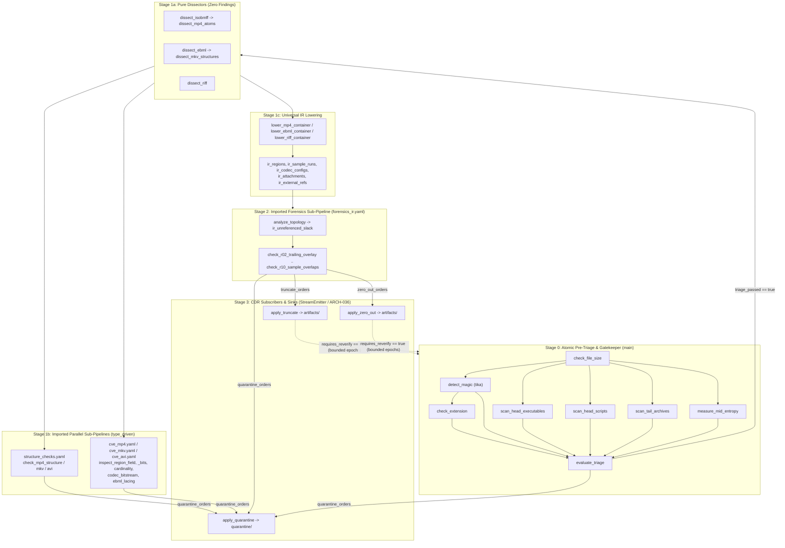

# VidSec — Multimedia Security Forensics & CDR Sanitization Engine

> High-performance, declarative binary container dissection, exploit detection, and Content Disarm & Reconstruction (CDR) pipeline built on **Flowdata v2**.

---

## 1. Overview

`apps/vidsec` inspects untrusted multimedia files (**ISOBMFF/MP4**, **EBML/Matroska/WebM**, and **RIFF/AVI**) in $O(\text{containers})$ I/O using pure format dissectors, declarative YAML CVE compendiums, format-agnostic Universal Container IR forensics (`R01`–`R10`), and zero-copy `StreamEmitter` CDR sanitization.

All orchestration, policy gating, and exploit assertions are driven declaratively from [`configs/pipeline.yaml`](./configs/pipeline.yaml) and its imported sub-pipelines ([`configs/pipelines/`](./configs/pipelines/)), executed by [`libanalyzer.so`](./src/catalog.zig) on the Flowdata v2 engine:

- **Pure Format Dissectors (`libs/`) & Universal Container IR ([ARCH-035](../../docs/development/035-vidsec-libs-extraction-and-rebuild-plan.md))**: Standalone `std`-only binary parsers (`libs/tika`, `libs/isobmff`, `libs/ebml`, `libs/riff`) separate structural dissection (Stage 1a) from security policy, lowering containers into `libs/media_ir` (with run-coalesced `IrSampleRunRow` streams to prevent table explosions).
- **Federated `type_driven` Routing & YAML `imports:` ([ARCH-035d](../../docs/development/035d-subpipeline-imports-and-type-driven-multi-pipeline-routing.md))**: `configs/pipeline.yaml` imports modular sub-pipelines (`structure_checks`, `cve_mp4`, `cve_mkv`, `cve_avi`, `forensics_ir`) compiled into one federated reactive DAG. Each video is dissected **once** per epoch while matching structural checks, CVE assertions, and IR rules run concurrently on `WorkerPool`.
- **Declarative CVE Exploitation Compendium ([ARCH-035c](../../docs/development/035c-vidsec-declarative-cve-primitives-and-compendium.md))**: Reusable YAML-parameterized inspection tasks (`inspect_region_field`, `inspect_region_bits`, `check_region_cardinality`, `inspect_codec_bitstream`, `inspect_ebml_lacing`) encode real-world CVEs across Stagefright, AppleAVD, FFmpeg, CoreMedia, and `libebml` without recompiling Zig code.
- **Zero-Copy Streaming CDR & Bounded Re-Verification ([ARCH-036](../../docs/development/036-streaming-output-emitter-and-chunked-sinks.md))**: Remediation tasks (`apply_truncate`, `apply_zero_out`, `apply_quarantine`) operate in $O(1)$ RAM via `abi.StreamEmitter` (`PieceTable`) over `BoundedStreamReader`, routing sanitized outputs into causal re-verification epochs (`max_activations_per_node: 3`) or hostile artifacts to `quarantine`.
- **Unified SQLite + Memory State ([`configs/schemas.yaml`](./configs/schemas.yaml))**: Structured schema definitions across `catalog`, `triage`, `ir_core`, `ir_deep`, and `audit` tables persisted declaratively in `audit_db`.

---

## 2. DAG Topology & Federated 6-Stage Dataflow

VidSec executes a 6-stage federated reactive pipeline where Stage 0 gates unsafe headers, Stage 1a dissects the container once, Stage 1b fans out across imported sub-pipelines in parallel, Stage 1c lowers into `media_ir`, Stage 2 audits container invariants (`R02`–`R10`), and Stage 3 applies CDR or quarantine:



---

## 3. Forensic Rules & Declarative CVE Primitives

### Generalist Structural & IR Forensic Rules (`R01`–`R10`)
| Rule | Pipeline / Stage | Task(s) | Scope & Security Invariant |
| :--- | :--- | :--- | :--- |
| **R01** | Stage 0 / `structure_checks` | `detect_magic`, `check_extension`, `check_*_structure` | Magic-vs-extension consistency and valid root signatures (`ftyp`, `EBML`, `RIFF`). |
| **R02** | `forensics_ir` | `check_r02_trailing_overlay` | Detects trailing bytes / polyglots past `highest_root_end`; emits `TruncateOrder` or `QuarantineOrder`. |
| **R03** | `structure_checks` | `check_mp4_structure`, `check_mkv_structure`, `check_avi_structure` | Box/element/chunk containment bounds, integer overflows, and recursion depth caps. |
| **R04** | `forensics_ir` | `check_r04_sample_bounds` | Verifies every `IrSampleRunRow` stays strictly inside `media_data` regions (`[start, end) <= file_size`). |
| **R05** | `forensics_ir` | `check_r05_external_refs` | Detects external URI/UNC/SMB/`file://`/traversal references (`dref`) risking SSRF or local file leak. |
| **R06** | `forensics_ir` | `check_r06_embedded_attachments` | Audits embedded attachments (`AttachedFile`, items) for path traversal, executables, risky fonts, and MIME spoofing. |
| **R07** | `forensics_ir` | `check_r07_suspicious_padding` | Multi-window scan over padding/filler boxes (`free`, `skip`, `Void`, `JUNK`) for embedded payloads (`ZeroOutOrder`). |
| **R08** | `forensics_ir` | `check_r08_unreferenced_slack` | Scans Level-1 external gaps and Level-2 interior `mdat`/`Cluster`/`movi` slack for encrypted/hidden blobs (`ZeroOutOrder`). |
| **R09** | `structure_checks` / `forensics_ir` | `check_*_structure`, `check_r09_codec_inconsistencies` | Validates codec config headers (`avcC`, `hvcC`, `esds`, `strf`) and cross-checks container vs. bitstream SPS dimensions. |
| **R10** | `forensics_ir` | `check_r10_sample_overlaps` | Detects overlapping `IrSampleRunRow` intervals and read/decompression amplification bombs. |

### Declarative CVE Primitives ([`configs/pipelines/cve_*.yaml`](./configs/pipelines/))
| Primitive Task | Mechanism | Example CVEs Modeled Declaratively |
| :--- | :--- | :--- |
| `analyzer/inspect_region_field` | Typed scalar / stride / bounds / FourCC assertions at region offsets | `CVE-2015-1538` (`stsc` stride), `CVE-2015-1539` (`esds`), `CVE-2015-3824` (`tx3g`), `CVE-2015-3829` (`covr`), `CVE-2018-19937` (`mdhd`), `CVE-2019-13615` (`EBMLMaxSizeLength`), `CVE-2021-38114` (`strh`/`strf`) |
| `analyzer/inspect_region_bits` | Masked/shifted sub-byte bitfields & hex-prefixed `uuid` payloads | `CVE-2015-3864` (`uuid` vendor overflow), `CVE-2022-22675` (`avcC` `lengthSizeMinusOne` forbidden value) |
| `analyzer/check_region_cardinality` | Singleton / per-parent child multiplicity & ordering checks | `CVE-2018-13300` (duplicate `stsc`), `CVE-2020-22019` (duplicate `CodecPrivate`), `CVE-2017-9992` (duplicate `strf`) |
| `analyzer/inspect_codec_bitstream` | Zero-allocation Exp-Golomb (`ue(v)` / `se(v)`) H.264 SPS decoder | `CVE-2021-30860` & SPS parameter/dimension bounds (`avcC` / MKV `CodecPrivate`) |
| `analyzer/inspect_ebml_lacing` | Matroska `Block`/`SimpleBlock` Xiph, Fixed & EBML lacing delta validator | `CVE-2016-1621` & compressed frame-lacing size-sum bounds |

---

## 4. Configuration & Modular Layout

### Configuration Files
- [`configs/pipeline.yaml`](./configs/pipeline.yaml): Global `runtime` (`routing: type_driven`, `scheduler: dag`, `max_activations_per_node: 3`, `max_inflight_bytes: 512MiB`), datasources, module loading (`libanalyzer.so`), `imports:`, Stage 0 triage, Stage 1a dissectors, Stage 1c IR lowering, and Stage 3 CDR subscribers.
- [`configs/schemas.yaml`](./configs/schemas.yaml): Declarative SQLite schemas (`catalog`, `triage`, `ir_core`, `ir_deep`, `audit`).
- Sub-pipelines under [`configs/pipelines/`](./configs/pipelines/):
  - [`structure_checks.yaml`](./configs/pipelines/structure_checks.yaml) — Container structural validators (`MP4`, `MKV`, `AVI`)
  - [`cve_mp4.yaml`](./configs/pipelines/cve_mp4.yaml) — ISOBMFF/MP4 exploit assertions
  - [`cve_mkv.yaml`](./configs/pipelines/cve_mkv.yaml) — EBML/Matroska exploit & lacing assertions
  - [`cve_avi.yaml`](./configs/pipelines/cve_avi.yaml) — RIFF/AVI exploit assertions
  - [`forensics_ir.yaml`](./configs/pipelines/forensics_ir.yaml) — Topology & `R02`–`R10` format-agnostic forensic pipeline

### Datasources & Environment Variables
| Datasource / Variable | Role / Purpose | Default |
| :--- | :--- | :--- |
| `pipeline_memory` | `memory` (`role: duplex`) | Ephemeral inter-step blackboard tables & orders |
| `audit_db` (`VIDSEC_DB_PATH`, `VIDSEC_SCHEMA_PATH`) | `sqlite` (`role: duplex`) | `./vidsec_state.db` / `./configs/schemas.yaml` |
| `artifacts` | `file_store` (`role: sink`) | `./artifacts/` |
| `quarantine` | `file_store` (`role: sink`) | `./quarantine/` |

---

## 5. Building, Testing, and Running

### Prerequisites
- [Zig](https://ziglang.org/download/) `0.17.1` (`0.17.x`)
- SQLite3 development library (`libsqlite3`)

### Build Binary and Plugin (`libanalyzer.so`)
```bash
cd apps/vidsec
zig build
```

### Run Test Suites
```bash
# Run VidSec container, triage, forensics, CVE, and E2E pipeline suites
cd apps/vidsec
zig build test --summary all
```

### Execute the CLI
```bash
cd apps/vidsec

# Inspect CLI flags and subcommands (e.g. validate, run, serve)
./zig-out/bin/vidsec --help
```

---

## 6. Architecture Roadmap
* Master Index: [`docs/development/000-architecture-roadmap.md`](../../docs/development/000-architecture-roadmap.md)
* `vidsec` Series:
  * [`ARCH-035`](../../docs/development/035-vidsec-libs-extraction-and-rebuild-plan.md) — Pure Dissector Libraries (`libs/`) & Initial Rebuild (*Implemented*)
  * [`ARCH-035b`](../../docs/development/035b-vidsec-pure-dissection-and-declarative-analysis-pipeline.md) — Pure Dissection & Full Declarative `R01`–`R10` Pipeline (*Implemented*)
  * [`ARCH-035c`](../../docs/development/035c-vidsec-declarative-cve-primitives-and-compendium.md) — Declarative CVE Primitives & Real-World Vulnerability Compendium (*Implemented*)
  * [`ARCH-035d`](../../docs/development/035d-subpipeline-imports-and-type-driven-multi-pipeline-routing.md) — Sub-Pipeline `imports:` & Federated `type_driven` Routing (*Implemented*)
  * [`ARCH-035e`](../../docs/development/035e-vidsec-holistic-sanitization-and-triage-remediation.md) — Holistic CDR Sanitization, Triage Remediation & OS Thumbnailer / Quarantine Armoring (*Specified*)
  * [`ARCH-035f`](../../docs/development/035f-vidsec-declarative-yaml-cve-auto-remediation.md) — Zero-Recompilation Declarative YAML CVE Auto-Remediation (`on_fail:`) (*Specified*)
  * [`ARCH-036`](../../docs/development/036-streaming-output-emitter-and-chunked-sinks.md) — Streaming `StreamEmitter` & Bounded Causal Re-Verification (*Implemented*)

